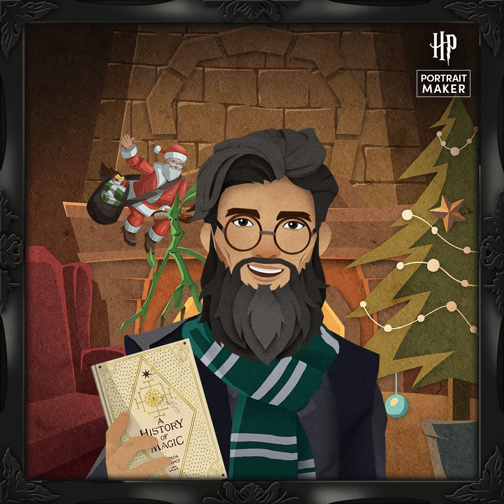
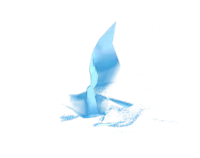
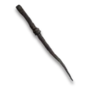

  <h1>Habib Zreik</h1>
  
<em>Mechatronics Engineer | Gryffindor 🦁</em>

  

    <a href="https://zreik.me">zreik.me</a> • 
    <a href="https://linkedin.com/in/habib-zreik">LinkedIn</a> • 
    <a href="https://bsky.app/profile/hzreik.bsky.social">Bluesky</a>
  

---

  <table>
    <tr align="center">
      <th rowspan="4"></th>
      <th>House</th>
      <th>Patronus</th>
      <th>Wand</th>
      <th>Origin</th>
    </tr>
    <tr align="center">
      <td></td>
      <td></td>
      <td></td>
      <td>🌌</td>
    </tr>
    <tr align="center">
      <td><b>Gryffindor</b></td>
      <td><b>Robin</b></td>
      <td><b>Acacia</b></td>
      <td><b>Synnax</b></td>
    </tr>
  </table>

---

  <table>
    <tr>
      <td align="center" width="33%">
        <h3>Core</h3>
        
M.Sc. Mechanical Engineering (Mechatronics) University of Duisburg-Essen

      </td>
      <td align="center" width="33%">
        <h3>Stack</h3>
        
Python • C++ • ROS2 • Arduino

      </td>
      <td align="center" width="33%">
        <h3>Focus</h3>
        
Robotics • Autonomous Systems • Astronomy

      </td>
    </tr>
  </table>

 

  

